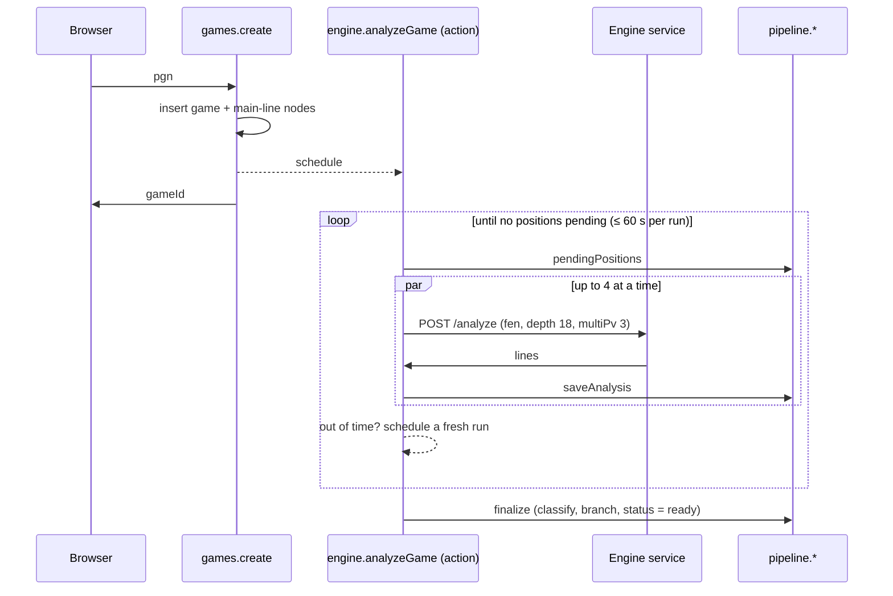

# Analysis pipeline

From "Analyze game" to a classified tree. Code: `web/convex/games.ts`, `engine.ts`,
`pipeline.ts`.



## 1. Import (`games.create`, mutation)

- Parses the PGN with `parseGame` (chess.js). A bad PGN throws a `ConvexError` the import form
  shows. The browser runs the same parse first so most errors never reach the server.
- Inserts the `games` row (`status: 'analyzing'`) and one `nodes` row per main-line position,
  root first, each pointing at the previous one.
- Schedules `internal.engine.analyzeGame` and returns the id.

## 2. Engine pass (`engine.analyzeGame`, action)

- Asks `pipeline.pendingPositions` for main-line positions with no saved analysis
  (deduplicated by `positionKey`, so repeated positions and positions already analyzed in other
  games are skipped).
- Sends them to the engine service (`ENGINE_URL`, `ENGINE_TOKEN`; the game fails with a clear
  error if they're unset), 4 requests in flight (`CONCURRENCY`). The service queues what it can't
  run at once.
- Workers pull positions from a shared queue and save each result immediately with
  `pipeline.saveAnalysis`. That's what drives the progress bar.
- **Time slicing.** Each run stops taking new positions after `RUN_BUDGET_MS = 60 s` and schedules
  a fresh run of itself. Convex actions have a 10-minute limit; slicing keeps every run far from
  it and makes the pipeline resumable. A rerun simply picks up whatever is still pending.
- When nothing is pending, it calls `pipeline.finalize`.
- Any thrown error is logged and the game is marked `failed` with the message
  (`pipeline.markFailed`).

Terminal positions (checkmate, stalemate, insufficient material) are never sent to an engine:
they're saved with `terminal` set and no lines.

## 3. Finalize (`pipeline.finalize`, mutation)

Runs only if the game is still `analyzing` (so a duplicate run is harmless). For each main-line
move (`classifyAndBranch`):

1. Loads the analysis before the move (its engine lines) and after it (its best score, or the
   fixed score of a finished position).
2. `judgeMove` returns `classification`, `winPercentLoss`, `onlyMove`, `critical`, which are
   patched onto the node. See [move classification](move-classification.md).
3. At a critical move (a mistake or blunder), it takes the engine's best line from the position
   *before* the move that isn't the played move (`BRANCH_ALTERNATIVES = 1`), plays it for
   `BRANCH_PLIES = 5` plies, and inserts it as `engine` nodes under the parent position.

Then sets `status: 'ready'`.

## Re-running classification

Thresholds are meant to be tuned. To redo step 3 for a finished game without re-running the
engine (from `web/`):

```bash
npx convex run pipeline:reclassify '{"gameId": "<id>"}'
```

It deletes the game's `engine` nodes and runs `classifyAndBranch` again. It does not touch `user`
nodes.

To redo everything including the engine pass, use `pipeline:reanalyze` (same argument): it drops
the engine branches, analyzes any positions without a saved analysis, and finalizes again. Pair
it with `pipeline:purgeAnalyses '{"engine": "<name>"}'` to throw away analyses from a given engine
(for example after changing engine version or settings) and recompute them.

## Timing (depth 18, MultiPV 3, per position)

| Where | Typical |
| --- | --- |
| Engine service on Fly (`shared-cpu-2x`, 2 engines) | 1–2.3 s per search |
| Native Stockfish on a laptop | 2–6 s per search |

Measured end to end: a 65-move game (130 positions) finished in about 50 s, with some positions
already cached. The old WASM-in-Convex engine took 6–17 s per position ([decisions](decisions.md)).
