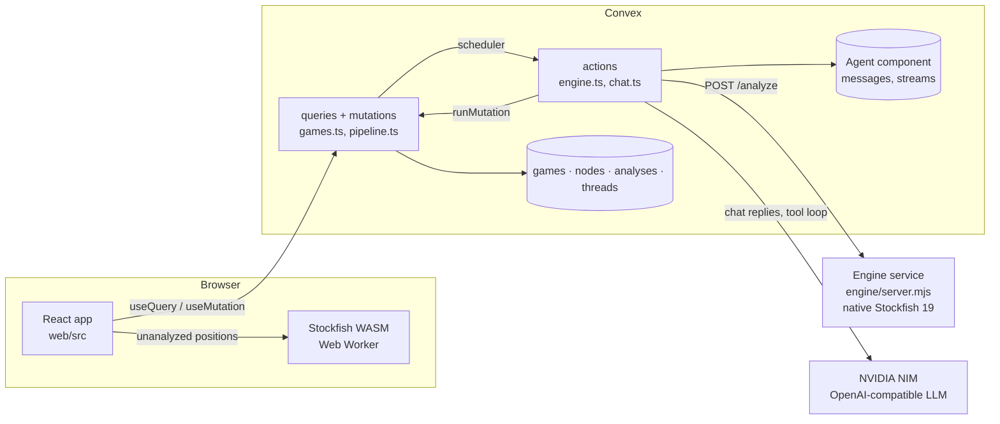

# Architecture

Variant turns one finished chess game into a tree of positions you can explore. The game's moves
form the main line; at the moments that decided the game, the tree branches into the engine's
alternatives (and, from milestone 5, the user's own what-ifs).

## Ground rule

**Stockfish and deterministic code decide what is true. The LLM (milestone 4+) only explains it.**
Every evaluation, classification and branch in the database comes from the engine plus code in
`packages/chess-core`. Nothing the UI shows as fact is generated text.

## Pieces



| Piece | Where | Job |
| --- | --- | --- |
| Web app | `web/src/` | Vite + React 19. Board (react-chessboard), variation tree (React Flow), engine lines, move list |
| Browser engine | `web/src/engine/` | Stockfish 19 lite (WASM) in a Web Worker. Live evals for positions the server hasn't analyzed. Never writes to the database |
| Backend | `web/convex/` | Convex: schema, PGN import, the analysis pipeline, classification, tree queries, node chat. Reactive queries push updates to the browser live |
| LLM | NVIDIA NIM (`lib/llm.ts`) | Explains positions in the chat, calling tools for every fact ([node chat](chat.md)) |
| Engine service | `engine/` | Native Stockfish 19 behind a small authenticated HTTP API. Deployed separately (Docker) |
| Shared logic | `packages/chess-core/` | Pure TypeScript used by both the browser and Convex: PGN/UCI parsing, scores and win %, move classification |

## A game's life

1. **Import.** The browser parses the PGN locally (fast error), then calls `games.create`. The
   mutation stores the game and one `nodes` row per position of the main line, and schedules
   the analysis action. The browser navigates to `#/game/<id>` immediately.
2. **Analyze.** `engine.analyzeGame` sends every main-line position to the engine service
   (depth 18, 3 lines each) and saves results to `analyses`. The game page's progress bar moves
   as each one lands, because the page's query re-runs automatically.
3. **Finalize.** Once every position has an analysis, `pipeline.finalize` judges each move,
   marks critical moments, and inserts the engine's top alternatives there as `engine` nodes.
   The game becomes `ready`, and the tree and summary appear.
4. **Explore.** The page reads the whole tree in one query (`games.tree`). Selecting a position
   shows its saved analysis; positions without one (deep in an engine line, or user moves later)
   get live analysis from the browser engine.
5. **Ask.** Each position has a chat. A question goes to the LLM with the position's fact sheet;
   the model checks moves and evaluations with tools before answering, and the reply streams
   in. See [node chat](chat.md).

Details: [analysis pipeline](analysis-pipeline.md), [move classification](move-classification.md).

## Conventions that hold everywhere

- **Scores are from White's point of view** (`{cp}` or `{mate}`), except raw UCI output, which
  is side-to-move and gets flipped once at the boundary (`toWhitePov`).
- **Positions are cached by `positionKey`** (the first four FEN fields), so a position reached by
  different move orders, or in different games, is analyzed once.
- **The tree is a parent-pointer table.** Each node is a position; the move that led to it lives
  on the node (`moveSan`, `moveUci`). The root has no parent and no move.
- **`source` says where a node came from:** `game` (played), `engine` (alternative at a critical
  moment), `user` (a what-if).
- **Convex code follows `web/convex/_generated/ai/guidelines.md`** (index names list their fields,
  queries are bounded with `.take()`, table-qualified `db.get/patch`, typed env via `defineApp`).

## Repository layout

```
engine/                  native Stockfish HTTP service (Dockerfile, server.mjs)
packages/chess-core/     shared chess logic + vitest tests
web/
  convex/                backend (schema, games, pipeline, engine actions, lib/)
  scripts/               prepare-stockfish.mjs (runs on install/dev/build)
  src/
    pages/               ImportPage (landing), GameView (explorer)
    components/          board-side widgets, GameTreeView, TopBar, TreePreview
    engine/              browser Stockfish wrapper + useAnalysis hook
    lib/                 GameTree index, tree layout (+ tests)
docs/                    you are here
```
